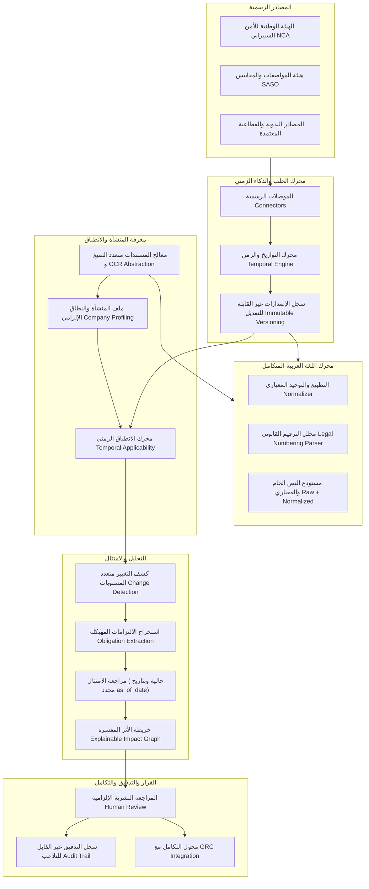

# وثيقة المعمارية الفنية والمنهجية الهندسية لمشروع «مآل – Maal»
**النسخة:** 2.5 (شاملة ومفصلة)
**اللغة:** العربية (مع المصطلحات التقنية بالإنجليزية)
**الحالة:** معتمدة للتنفيذ الهندسي (Engineering Approved)

---

## 1. تعريف المشكلة (Problem Definition)

تواجه المنشآت العاملة في المملكة العربية السعودية والمنطقة تحديات تنظيمية غير مسبوقة ناتجة عن تسارع وتيرة التحديثات التشريعية الصادرة عن جهات رقابية متعددة (مثل: الهيئة الوطنية للأمن السيبراني NCA، الهيئة السعودية للمواصفات والمقاييس والجودة SASO، هيئة الحكومة الرقمية DGA، والبنك المركزي السعودي SAMA).

تتمثل المشكلة في الفجوة الواسعة بين:
1. **طريقة صدور التشريع:** نصوص قانونية طويلة، غير مهيكلة، تُنشر في بوابات رسمية مختلفة بصيغ PDF أو HTML، وتتضمن تواريخ نشر، تواريخ نفاذ مستقبلية، وفترات سماح وتوفيق أوضاع.
2. **الواقع التشغيلي للمنشأة:** سياسات داخلية معقدة، عقود، إجراءات تشغيلية، مشاريع قائمة، وأنظمة تقنية موزعة بين إدارات شتى.

الأنظمة الحالية إما مجرد لوحات تنبيهات تكتفي بإشعار "صدر تعميم جديد"، أو أنظمة GRC تعتمد كلياً على الإدخال اليدوي البطيء وعرضة للخطأ البشري. هذا العجز يؤدي إلى غرامات مالية باهظة، تأخر المشاريع، ومخاطر فقدان تراخيص العمل لعدم الامتثال في الوقت المحدد.

---

## 2. أهداف النظام (System Goals)

1. **الانتقال من مراقبة اللوائح إلى قياس الأثر المباشر:**
   $$\text{Regulatory Change} \longrightarrow \text{Company Impact} \longrightarrow \text{Actionable Compliance Task}$$
2. **معاملة اللغة العربية كمواطن أصيل (First-Class Citizen):**
   معالجة دقيقة للنصوص العربية القانونية، والأرقام الهندية/المشرقية، والترقيم القانوني للمواد والبنود، وصيغ التواريخ العربية والهجرية دون تشويه النص الأصلي المعتمد كدليل قانوني.
3. **الذكاء الزمني التنظيمي (Temporal Regulatory Intelligence):**
   تتبع الحالة القانونية للتشريعات عبر الزمن، والتمييز بين تاريخ الجلب وتاريخ النفاذ، وإمكانية فحص الامتثال بأثر رجعي في تاريخ محدد (`as_of_date`) أو بالوضع الحالي، ومراعاة فترات توفيق الأوضاع (Grace Periods).
4. **معمارية هجينة تجمع بين الصرامة الحتمية والذكاء الاصطناعي (Hybrid Architecture):**
   الاعتماد على المنطق الحتمي (Deterministic Logic) في التواريخ، المقارنات الرقمية، البصمات، وسجل الإصدارات، مع توظيف الذكاء الاصطناعي في الفهم الدلالي، استخراج الالتزامات المعقدة، والترابط متعدد اللغات.
5. **إسناد وتفسير مطلق غير قابل للاختلاق (Zero Hallucination & Full Provenance):**
   ربط كل ملاحظة أو مهمة بالدليل الأصلي وموضعه الدقيق (صفحة، فقرة، مادة، خلية)، والامتناع التام عن توليد بيانات وهمية، وعرض `Live source not configured` صراحةً عند عدم توفر موصل رسمي.
6. **فصل المعرفة التنظيمية عن معرفة المنشأة:**
   عزل تام بين قاعدة المعرفة التشريعية العامة (Regulatory KB) وقاعدة معرفة وثائق المنشأة الخاصة (Company KB).

---

## 3. غير المستهدفات (Non-Goals)

1. **تقديم استشارات قانونية ملزمة:** النظام أداة ذكاء اصطناعي لدعم القرار (Decision Support Tool)، والمراجعة البشرية إلزامية لاعتماد أي إجراء.
2. **استبدال أنظمة الـ GRC المؤسسية:** النظام يتكامل مع أنظمة GRC الحالية ولا يسعى ليكون بديلاً كاملاً عنها على مستوى إدارة المؤسسة.
3. **الاعتماد على التعرف الضوئي (OCR) السحابي الخارجي في النسخة الحالية:** توفير طبقة تجريد وتصنيف جودة واضحة للمستندات الممسوحة مع إمكانية دمج محرك محلي لاحقاً دون إرسال البيانات لطرف خارجي غير موثوق.
4. **التعقيد المعماري غير المبرر:** عدم استخدام بنية Microservices أو Kafka أو Kubernetes أو قواعد بيانات متجهة خارجية في هذه المرحلة؛ والاعتماد على SQLite مع مسار مهيكل للانتقال إلى PostgreSQL.

---

## 4. المعمارية الحالية (Current Architecture)

تتألف المعمارية الحالية من:
- **FastAPI** لتخديم الواجهات البرمجية وتوليد الواجهة الثابتة.
- **SQLite3** مع تمكين وضع `WAL` ومفتاح الربط الخارجي.
- **موصلات الويب:** NCA و SASO لجلب اللوائح الرسمية، وموصل يدوي.
- **مكتبة استخراج المستندات:** تستخرج النصوص من 6 صيغ مع حفظ المواقع الأساسية.
- **محرك كشف التغييرات:** يقارن نصوص المواد برمجياً بالاعتماد على الفروق النصية والأرقام اللاتينية.
- **آلة حالات تشغيل:** تدير عمليات التحليل والتدقيق والمراجعة البشرية.

---

## 5. المعمارية المستهدفة (Target Architecture)

---

## 6. مسار تدفق البيانات (Data Flow)

1. **اكتشاف التشريع:** يقوم الموصل بجلب المحتوى والبيانات الوصفية الرسمية وبصمة التشفير.
2. **التحليل الزمني:** يُفحص تاريخ النشر، وتاريخ النفاذ، وحالة اللائحة (نافذة، مسودة، ملغاة، فترة سماح).
3. **المعالجة العربية:** استخراج النصوص مع حفظ النص الأصلي `raw_text` وتوليد النص المعياري `normalized_text` وترقيم المواد القانونية.
4. **تحديد النطاق والانطباق:** مطابقة اللائحة بنطاق المنشأة المعتمد (الاستنتاجي + الإلزامي + المؤكد) حسب التاريخ المعتمد للتحليل.
5. **استخراج الالتزامات وكشف الفروق:** مقارنة النسخة السابقة بالنسخة الحالية، وتحديد نوع التغيير (رقمي، موعد، نطاق، مسؤولية، تحريري).
6. **مراجعة الامتثال:** فحص وثائق المنشأة مقابل الالتزامات وتوليد النتائج مع درجات الثقة والمواقع المحددة.
7. **المصادقة والتكامل:** تمرير التوصيات للمراجعة البشرية وتصدير المهام إلى GRC وتوثيق كل حدث في سجل التدقيق.

---

## 7 إلى 24. التفصيل المعماري للمكونات الأساسية (Component Breakdown)

### 7. محرك جلب اللوائح الرسمية (Regulatory Ingestion Engine)
- **ماذا يفعل؟** يتصل بالمصادر الرسمية، يجلب المحتوى، يفهرس البيانات الوصفية، ويتحقق من البصمات.
- **لماذا نحتاجه؟** لضمان استقاء المعلومات من مصادرها الرسمية الموثوقة دون وسيط تجاري.
- **المدخلات:** روابط الصفحات الرسمية، واستعلامات الجلب.
- **المخرجات:** ملفات رقمية مخزنة، بصمات `SHA-256`، وسجلات `RegulatoryDocument`.
- **مكان التخزين:** التخزين المحلي المنظم `data/regulatory/raw/` وجدول `regulatory_documents`.
- **الخوارزمية:** جلب تكراري غير متزامن مع حماية ضد التكرار (Idempotency) وفصل الجلسات.
- **نوع المنطق:** حتمي (Deterministic).
- **البدائل المرفوضة:** الاعتماد على الـ RSS feeds أو مواقع الأخبار؛ رُفضت لضعف حجيتها القانونية وتأخرها.

### 8. محرك المعالجة المتقدمة للغة العربية (Arabic Processing Engine)
- **ماذا يفعل؟** يقدم طبقة مركزية لمعالجة النصوص العربية، تدعم:
  - توحيد الهمزات (أ، إ، آ $\rightarrow$ ا)، الياء والألف المقصورة (ي، ى $\rightarrow$ ي)، التاء المربوطة والهاء (ة $\rightarrow$ ه)، إزالة التطويل والتشكيل.
  - تحويل الأرقام الهندية/المشرقية (`٠-٩`) إلى أرقام قياسية (`0-9`).
  - تفكيك الترقيم القانوني للمواد العربية (مثل: "المادة (٥)"، "المادة الخامسة"، "البند أولاً").
  - الحفاظ التام على زوج النصوص: `raw_text` للعرض والأدلة القانونية، و `normalized_text` للبحث والتحليل.
- **لماذا نحتاجه؟** لأن اللغة العربية هي اللغة القانونية الأساسية، والإهمال في تطبيعها يؤدي إلى فشل البحث والربط، كما أن تطبيع النص الأصلي يفسد الدليل القانوني.
- **نوع المنطق:** حتمي مبني على قواعد وخوارزميات معيارية (Unicode NFKC + Regular Expressions).
- **المخاطر:** المبالغة في التطبيع قد تطمس فوارق دلالية؛ لذلك تم اعتماد ازدواجية الحفظ (`raw` و `normalized`).

### 9. محرك معالجة المستندات متعددة الصيغ وتجريد الـ OCR (Document Processing & OCR Abstraction)
- **ماذا يفعل؟** يستخرج النصوص والبيانات الهيكلية من صيغ `PDF, DOCX, XLSX, PPTX, TXT, CSV`.
- **المواقع الدقيقة (Exact Locators):** الحفاظ على `page, section, heading, paragraph, table, row, column, sheet, cell, slide, line`.
- **تجريد جودة الاستخراج:** تصنيف جودة قراءة كل مستند إلى:
  - `extraction_success`: نص واضح ومستخرج بالكامل.
  - `partial_extraction`: نقص طفيف في النصوص أو الجداول.
  - `low_quality`: كثافة نصية منخفضة أو نصوص غير مفهومة.
  - `OCR_required`: ملف مصور يحتاج معالجة ضوئية، مع الامتناع عن الادعاء بقراءته.
- **نوع المنطق:** حتمي مع فحوصات إحصائية للكثافة النصية.

### 10. محرك بناء ملف المنشأة والنطاق التنظيمي (Company Profiling & Scope Engine)
- **ماذا يفعل؟** يحلل وثائق المنشأة المرفوعة لاستخراج الحقائق التشغيلية وبناء النطاق التنظيمي الإلزامي:
  $$\text{Scope} = \text{Inferred} + \text{Mandatory Baseline} + \text{User Confirmed}$$
- **القواعد الصارمة:**
  - موظفون $\rightarrow$ نطاق العمل والتوظيف إلزامي.
  - نظم معلومات $\rightarrow$ الأمن السيبراني إلزامي.
  - بيانات شخصية $\rightarrow$ حماية البيانات الشخصية إلزامي.
  - تصنيع $\rightarrow$ مواصفات ومطابقة المنتجات إلزامي.
  - استيراد/تصدير $\rightarrow$ الرقابة على الصادرات والجمارك إلزامي.
  - موردون $\rightarrow$ المشتريات وسلاسل الإمداد إلزامي.
- **المصادر غير المفعلة:** إظهار `Live source not configured` فوراً لأي نطاق دون موصل حي، دون أي اختلاق لوائح.

### 11. محرك الذكاء الزمني وتاريخ اللوائح (Temporal Regulatory Intelligence Engine)
- **ماذا يفعل؟** يحلل ويدير الخط الزمني لكل تشريع، بما يضمن:
  - التمييز بين: `retrieved_at` (تاريخ الجلب التقني)، `published_at` (تاريخ النشر)، `effective_at` (تاريخ النفاذ الإلزامي).
  - تتبع الحالة القانونية: `draft`, `published`, `effective`, `amended`, `superseded`, `repealed`, `expired`, `unknown`.
  - إدارة فترات السماح وتوفيق الأوضاع (Transition / Grace Periods): تصنيف الالتزامات إلى (`Upcoming Requirement`, `Transition Period`, `Action Required Before [date]`, `Currently Effective`, `Past Due`).
  - معالجة التواريخ الهجرية والميلادية العربية مع تسجيل نوع التقويم `calendar_type` ونسبة الثقة `conversion_confidence`.
- **نوع المنطق:** حتمي قائم على الرياضيات الزمنية وتحويلات التقويم المعتمدة.

### 12. سجل إصدارات اللوائح غير القابلة للاستبدال (Immutable Regulatory Versioning)
- **ماذا يفعل؟** حفظ كل إصدار من اللائحة بـ `SHA-256` وبناء تسلسل هرمي لا يحذف القديم:
  $$\text{Regulation} \longrightarrow \text{Version 1} \xleftarrow{\text{supersedes}} \text{Version 2} \xleftarrow{\text{supersedes}} \text{Version 3}$$
- **لماذا نحتاجه؟** لتمكين التدقيق الرجعي الصارم؛ القرارات التي اتخذتها المنشأة في تاريخ سابق يجب أن تُحاكم بلائحة ذلك التاريخ وليس باللائحة المعدلة لاحقاً.

### 13. كشف التغييرات متعدد المستويات (Multi-Level Change Detection)
- **ماذا يفعل؟** يقارن نسختين (Version A $\rightarrow$ Version B) على مستويات:
  - اللائحة (Regulation)
  - المادة (Article)
  - الفقرة (Clause)
  - الالتزام (Obligation)
- **تصنيف التغيير:**
  - `added`, `removed`, `modified`
  - `numeric_threshold_changed` (تغير حد رقمي)
  - `deadline_changed` (تغير مهلة أو موعد)
  - `scope_changed` (تغير شروط الانطباق)
  - `responsibility_changed` (تغير الجهة المسؤولة)
  - `evidence_requirement_changed` (تغير متطلبات الإثبات)
  - `effective_date_changed` (تغير تاريخ النفاذ)
  - `editorial_only` (تغيير صياغي غير جوهري)
- **نوع المنطق:** حتمي في الأرقام والمواعيد والكلمات المفتاحية، مع إمكانية مساندة الذكاء الاصطناعي في الفروق الدلالية.

### 14. استخراج الالتزامات المهيكلة (Structured Obligation Extraction)
- **ماذا يفعل؟** يفكك المادة القانونية إلى التزامات صريحة:
  - الفاعل (Actor): من الملزم؟
  - الفعل (Action): ما المطلوب فعله؟
  - المشروطية (Modality): هل هو إلزامي (Must/Shall)، محظور (Prohibited)، أم خيار/ترخيص (Permission)؟
  - الاستثناءات (Exceptions) والشروط المسبقة.
  - الحدود الرقمية والمهل الزمنية المحددة.
- **نوع المنطق:** هجين (Deterministic Grammar + LLM Guardrails).

### 15. محرك الاسترجاع الهجين متعدد اللغات (Hybrid Multilingual Retrieval)
- **ماذا يفعل؟** استرجاع الأدلة ومطابقة المتطلبات باستخدام:
  - التصفية المسبقة بالبيانات الوصفية (Metadata Filters: اختصاص، مجال، تاريخ، حالة).
  - البحث النصي المعياري (BM25 / Full-text Search على `normalized_text`).
  - البحث الدلالي متعدد اللغات لتمكين الربط بين وثائق إنجليزية ولوائح عربية.
- **نوع المنطق:** هجين (Filter $\rightarrow$ BM25 $\rightarrow$ Semantic Matching).

### 16. محرك مراجعة الامتثال المعياري والتاريخي (Compliance Review Engine)
- **ماذا يفعل؟** مراجعة مستندات المنشأة وفق مسارين:
  1. **المراجعة الحالية (Current Review):** مقارنة الوثيقة باللوائح النافذة اليوم.
  2. **المراجعة بتاريخ محدد (Historical Review - `as_of_date`):** مقارنة الوثيقة باللوائح التي كانت نافذة في تاريخ محدد في الماضي.
- **الحالات المعتمدة للنتائج:**
  - `Compliant`: ممتثل بالكامل ومسنود بالدليل.
  - `Partially Compliant`: ممتثل جزئياً أو تنقصه بعض الضوابط.
  - `Non-Compliant`: مخالف للائحة المطبقة.
  - `Needs Review`: غموض يتطلب مراجعة قانونية.
  - `Insufficient Evidence`: غياب الدليل الكافي (لا يُحكم بالمخالفة دون دليل).
  - `Not Applicable`: غير منطبق على المنشأة أو المقطع.
- **مكونات النتيجة (Finding Schema):**
  تتضمن اللائحة، النسخة، الهيئة، المادة، تاريخ السريان، وثيقة المنشأة، الموضع الدقيق، نص الدليل، ملخص الاستدلال، الحالة، درجة الثقة، الإجراء المقترح، وحالة المراجعة البشرية.

### 17. خريطة الأثر المفسرة (Explainable Impact Mapping)
- **ماذا يفعل؟** يربط عناصر التغيير بكافة مفاصل المنشأة عبر مسار كامل مفسر:
  $$\text{Regulation} \rightarrow \text{Version} \rightarrow \text{Article} \rightarrow \text{Obligation} \rightarrow \text{Internal Document} \rightarrow \text{Section} \rightarrow \text{Department} \rightarrow \text{Project} \rightarrow \text{Finding}$$
- **بيانات كل رابط (Edge Metadata):**
  - نوع العلاقة (`implements`, `references`, `superseded_reference`, `violates`).
  - الدليل المسنود.
  - طريقة المطابقة (`exact_reference`, `keyword`, `semantic`, `structured_rule`, `human_confirmed`).
  - درجة الثقة (0.0 إلى 1.0).

### 18. محرك تقييم المخاطر والتعرض المالي (Risk & Financial Exposure)
- **ماذا يفعل؟** حساب التعرض المالي التقديري بدقة قائمة على مدخلات المنشأة المعتمدة، مع حظر كامل لاختلاق أي عقوبة مالية غير منصوص عليها في اللائحة أو غير مثبتة في أصول المنشأة، وعرض `Not enough data` فوراً عند غياب المدخلات.

### 19. خدمة المراجعة البشرية الإلزامية (Human Review Service)
- **ماذا يفعل؟** نقطة توقف إلزامية؛ لا تتحول مسودة المهمة أو النتيجة إلى إجراء نهائي دون مراجعة محلل أو مشرف بشري، مع دعم الاعتماد، التعديل مع إنشاء إصدار مراجعة جديد (`revision`)، أو الرفض مع بيان السبب.

### 20. تكامل الحوكمة والمخاطر (GRC Integration)
- **ماذا يفعل؟** تصدير المهام المعتمدة إلى محولات GRC محلية أو خارجية (مثل أدوات إدارة المهام وأنظمة الحوكمة المؤسسية) متضمنة سياق الأدلة ورابط الموضع.

### 21. سجل التدقيق الشامل (Comprehensive Audit Trail)
- **ماذا يفعل؟** تسجيل غير قابل للتلاعب لكافة الأحداث: المعرف، التشغيل، الفاعل، الدور، الحدث، الكيان، السبب، الأدلة، البصمات، والوقت الدقيق بصيغة UTC.

---

## 22. معمارية قاعدة البيانات والبيانات الوصفية (Data Model)

سيتم تعزيز قاعدة البيانات بتهجير جديد (`migrations/005_temporal_and_arabic_enhancements.sql`) يضيف:
1. حقول التاريخ الموسعة في `regulatory_documents`:
   - `publication_date_text`, `mandatory_application_date_text`, `hijri_date`, `calendar_type`.
2. حقول الحالة في `document_versions`:
   - `legal_status` (`draft`, `published`, `effective`, `amended`, `superseded`, `repealed`, `expired`, `unknown`).
   - `enforcement_date`, `repealed_date`, `grace_period_days`.
3. حقول النصوص المزدوجة في المقاطع:
   - `raw_text`, `normalized_text`, `language`, `extraction_quality`.
4. دعم `as_of_date` في جدول `compliance_reviews`.
5. توثيق روابط الأثر المفسرة في `document_dependencies` بحقول: `matching_method`, `confidence`, `rationale`.

---

## 23. معمارية الواجهات البرمجية (API Architecture)

- `GET /health`, `GET /ready`: فحص الجاهزية واتصال قاعدة البيانات.
- `GET /onboarding/status`: استعلام حالة إعداد المنشأة.
- `POST /onboarding/documents`: استيعاب وثائق متعددة وبناء ملف المنشأة.
- `POST /onboarding/{company_id}/approve`: مصادقة النطاق والملف المؤسسي.
- `POST /regulatory-scans`: إطلاق مسح للمصادر الرسمية غير متزامن.
- `GET /regulatory-scans/{id}`: متابعة تقدم المسح والتغييرات.
- `POST /compliance-reviews`: إجراء مراجعة امتثال (مع دعم اختياري لـ `as_of_date`).
- `POST /compliance-reviews/upload`: رفع وثيقة ومراجعتها مباشرة.
- `GET /compliance-reviews/{id}`: تقرير مراجعة الامتثال الشامل والأدلة.
- `GET /impact-graph`: شجرة الأثر المفسرة للكيانات.
- `POST /tasks/{id}/review`: مصادقة المراجعة البشرية للمهام.

---

## 24. استراتيجية الاختبارات (Testing Strategy)

- **اختبارات اللغة العربية:**
  - تطبيع الأرقام الهندية/المشرقية (`٠-٩`).
  - توحيد الهمزات، التاء المربوطة، والألف المقصورة.
  - استخراج ترقيم المواد القانونية العربية ("المادة (٥)"، "المادة الخامسة").
  - حفظ ثنائية النص الخام والمعياري.
- **اختبارات التواريخ والزمن:**
  - التواريخ الميلادية والهجرية وصيغها العربية.
  - فترات السماح والانتقال.
  - الاستعلام الزمني (`as_of_date`) ومقارنة نفاذ اللوائح.
- **اختبارات إصدارات اللوائح:**
  - تسلسل النسخ والإلغاء والاستبدال.
  - كشف التغييرات وتصنيفها بدقة.
- **اختبارات المستندات المتعددة:**
  - مستندات PDF, DOCX, XLSX, PPTX ثنائية اللغة وحفظ دقة المواقع.

---

## 25. الأمان وسلامة البيانات (Security & Privacy)

1. **عزل المعرفة المؤسسية:** عدم مشاركة بيانات الشركة مع أي فهرس عام.
2. **منع هجمات حقن الأوامر (Prompt Injection Defense):** معالجة نصوص الوثائق كبيانات غير موثوقة وعزلها عن توجيهات النظام.
3. **أمن المسارات (Path Traversal Protection):** التحقق من سلامة كافة مسارات التخزين ومنع الخروج من المجلدات المسموحة.
4. **التحكم بالصلاحيات (RBAC):** التحقق الصارم من أدوار المستخدمين والمراجعة البشرية.

---

## 26. خارطة التوسع المستقبلي (Future Scaling)

1. **الانتقال إلى PostgreSQL:** نقل الجداول والمخطط إلى PostgreSQL بسهولة عبر طبقة abstraction معدة، مع دعم البحث النصي الكامل باللغة العربية (`pg_trgm` و `arabic dictionary`).
2. **فصل العمال غير المتزامنين:** نقل تنفيذ المسح ومراجعة المستندات إلى طابور خلفي مستقل (مثل Celery / Redis أو Arq).
3. **محرك OCR محلي متقدم:** دمج نموذج معالجة بصرية محلي لملفات الـ PDF الممسوحة دون إرسال البيانات لطرف خارجي.

---
**نهاية وثيقة المعمارية الفنية والمنهجية الهندسية**
